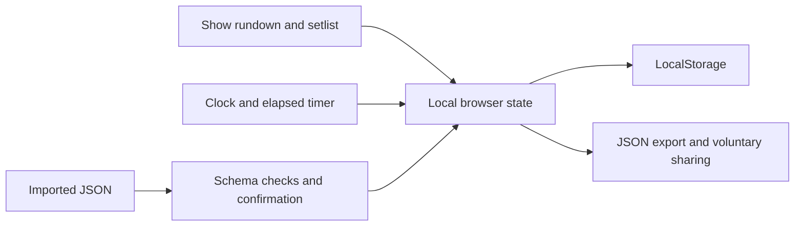

# Niko Live Commander — Studio Niko Design

**Local-first mobile show rundown · DJ preparation · Portable session backup**

 

[English overview](#english-overview) · [Portfolio](https://github.com/Nikoju1977)

## Architecture

| Source | Fonction |
| --- | --- |
| [index.html](index.html) | Conducteur, horloges, chronomètre, cues et partage |
| [backup.js](backup.js) | Validation des sauvegardes |
| [sw.js](sw.js) | Cache du shell applicatif |
| [manifest.webmanifest](manifest.webmanifest) | Métadonnées PWA |

Les horloges utilisent les fuseaux IANA via Intl.DateTimeFormat ; le chronomètre utilise l'heure du poste, qui peut être modifiée. Aucun retour de télémétrie audio ou vidéo n'est mesuré par ces fonctions.

PWA locale conçue pour préparer les lives et conserver un conducteur de session sur **ordinateur, iPhone et Android**, sans serveur ni compte.

## Fonctions réellement implémentées

- Conducteur avec titre, date, heure de Miami et notes.
- Horloges Paris/Miami calculées par `Intl.DateTimeFormat` (y compris les changements d'heure).
- Chronomètre avec démarrage, pause, reprise et remise à zéro.
- Cues régie INTRO / MIX / PAUSE / FIN.
- Checklist de préparation (audio BOOTH/iRig, microphone, niveau, caméra, connexion, droits).
- Setlist éditable : ajouter un titre, BPM facultatif, déplacer, supprimer.
- Sauvegarde automatique en stockage local du navigateur, export/import JSON.
- Copie/partage volontaire du conducteur et PWA avec cache hors ligne.

## Limites

**Ce projet ne contrôle ni TikTok LIVE, ni OBS, ni les platines Pioneer, ni l'iRig.** Aucun accès à des API privées TikTok, aucun streaming, aucun monitoring réel de l'audio ni télécommande des appareils d'autrui. La régie est locale et ne synchronise pas deux téléphones entre eux.

Pour un contrôle OBS local réellement configuré, voir [Angie Local Commander](https://github.com/Nikoju1977/Angie-local-commander) : nécessite OBS WebSocket 5, un serveur local et les permissions adaptées.

Les données sont stockées sur le téléphone ou l'ordinateur utilisé. Utiliser `Exporter JSON` pour les sauvegarder avant de vider le navigateur. Pas de clé d'API.

## Hébergement

Le dépôt peut être servi sur un hébergeur statique HTTPS (GitHub Pages, Vercel), sans installation de dépendances. **La présence du code GitHub n'active pas automatiquement l'hébergement** : sa publication doit être configurée et confirmée.

## Statut

Créé le 22 novembre 2026 à partir d'un dépôt vide. **Code enregistré ; tests navigateur, iPhone et déploiement public non confirmés.**

## Sécurisation de l'import — 22 novembre 2026

Le bouton **Importer JSON** est désormais une commande tactile et clavier. Le JSON est entièrement vérifié **avant toute modification** du conducteur existant (titre, notes, heure, BPM, check-list, durée et setlist). Un récapitulatif s'affiche et une confirmation explicite est nécessaire car l'import **remplace** les données locales. En cas d'annulation, de JSON invalide ou d'échec du stockage local, le conducteur précédent est conservé.

- Exports d'origine **sans champ `format`** toujours reconnus ; les nouveaux exports ajoutent `format: niko-live-commander-backup-v1`.
- Le chronomètre importé reste à l'arrêt, sans reprise automatique d'un ancien direct ; limite 1 Mo et 1 000 éléments.
- Le premier chargement de la PWA inclut désormais `backup.js` avec cache `niko-live-commander-v2-safe-import`.
- `node --test tests/backup.test.cjs` et `node tests/browser-smoke.cjs` sont exécutés par GitHub Actions. Le test Chromium utilise un serveur local, n'envoie aucune session sur un réseau social et n'est **pas** un essai sur iPhone physique.

La disponibilité HTTP 200 d'un domaine ne prouve pas la fiabilité des commandes de diffusion : l'application reste une régie de préparation autonome.

## Démarrage et qualification proposée

Servir le dépôt avec `python3 -m http.server 8000`, puis ouvrir http://localhost:8000/. Le code d'enregistrement du service worker exige ici HTTPS : ne pas déduire que le cache PWA est actif sur ce serveur HTTP.

Avec un conducteur fictif, vérifier les horloges, la reprise du chronomètre, l'ordre des titres, l'annulation d'un import et le rejet d'une sauvegarde invalide. Tester l'installation sur les appareils cibles via HTTPS. Les exports et le stockage local ne sont pas chiffrés. Aucun nouveau test ni déploiement n'a été exécuté pour cette révision.

## English overview

Niko Live Commander is a standalone browser-based preparation tool for DJ live sessions. It provides a rundown, time-zone clocks, timer, cues, a checklist, setlist, local persistence and validated JSON import. It does not broadcast, control TikTok or OBS, measure audio or synchronize devices. Native sharing and offline installation depend on browser support. No new runtime or production validation was performed.

## Licence

[LICENSE.md](LICENSE.md) : droits réservés pour les contributions originales concernées ; la publication ne constitue pas une licence open source. Aucun changement de licence.
